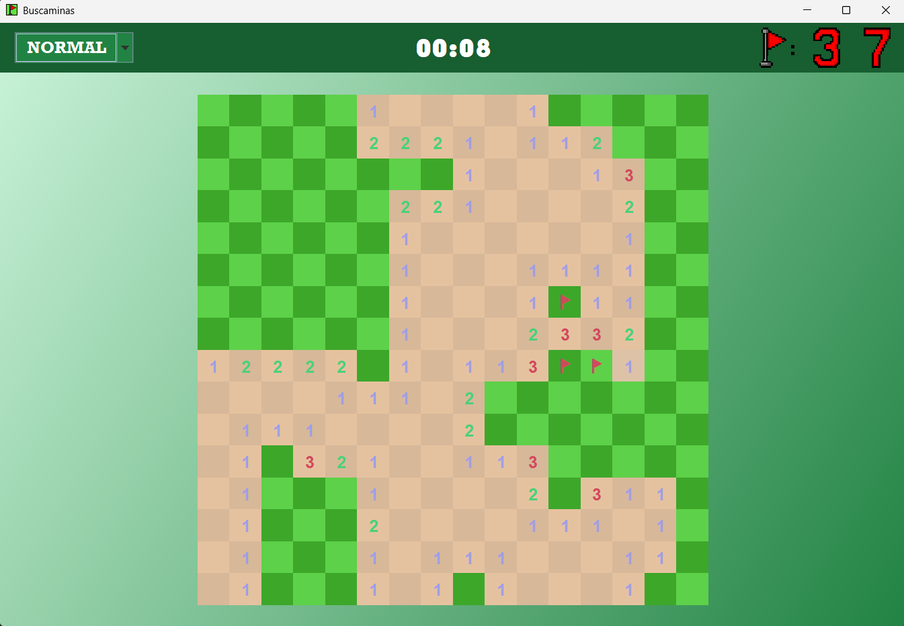

# Buscaminas


Una implementación con interfaz gráfica para jugar al buscaminas hecha en Java usando Swing.

| Pantalla de inicio | Partida |
|:---:|:---:|
|  |  |

## Descripción

El juego consiste en despejar un tablero de casillas sin revelar ninguna mina. El juego termina al revelar todas las casillas sin minas sin detonar ninguna. Para ello, las casillas cuentan con un número que indica el número de minas adyacentes a la propia casilla.

## Controles

- **Click izquierdo**: Despejar casilla.
- **Click derecho**: Colocar/quitar banderilla.
- **Click central**: Despejar vecinos si la casilla la tiene todos sus banderillas puestas.

## Características

- Hay **tres niveles de dificultad**: fácil (9x9, 10 minas), normal (16x16, 40 minas) y difícil (22x22, 99 minas).
- **Cronómetro** en la partida
- **Registro** de **mejores tiempos**  por dificultad
- Sistema de banderillas para marcar minas

## Recursos gráficos

Las imágenes utilizadas en el juego (números, banderilla e icono de la aplicación) se encuentran en la carpeta `src/Imagenes/` y son necesarias para la correcta ejecución del proyecto.

## Estructura

- `src/Clases/Casilla.java` — Modelo de cada casilla del tablero
- `src/Clases/Juego.java` — Lógica del juego
- `src/Clases/Tablero.java` — Interfaz gráfica
- `src/Clases/Records.java` — Gestor de los records en cada dificultad
- `src/App.java` — Main
- `src/Imagenes/` — Recursos gráficos del juego
- `docs/screenshot/` — Imagenes pare el README
- `records.txt` — Documento de texto con los records

## Instalación y ejecución

Es necesario contar con Java 8 o superior. Clona el repositorio y compile el proyecto desde la carpeta raíz del proyecto:

**Linux / macOS**
```bash
mkdir -p bin
javac -encoding UTF-8 -d bin src/App.java src/Clases/*.java
cp -r src/Imagenes bin/
java -cp bin App
```

**Windows**
```
mkdir bin
javac -encoding UTF-8 -d bin src\App.java src\Clases\*.java
xcopy /E /I /Y src\Imagenes bin\Imagenes
java -cp bin App
```

### Generar un .jar ejecutable (opcional)
**Linux / macOS**
```bash
jar cfe Buscaminas.jar App -C bin .
java -jar Buscaminas.jar
```
**Windows**
```
mkdir bin
javac -encoding UTF-8 -d bin src\App.java src\Clases\*.java
xcopy /E /I /Y src\Imagenes bin\Imagenes
jar cfe Buscaminas.jar App -C bin .
```

## Autor

Álvaro Vicente Bonilla - [AlvaroVicente28](https://github.com/AlvaroVicente28)